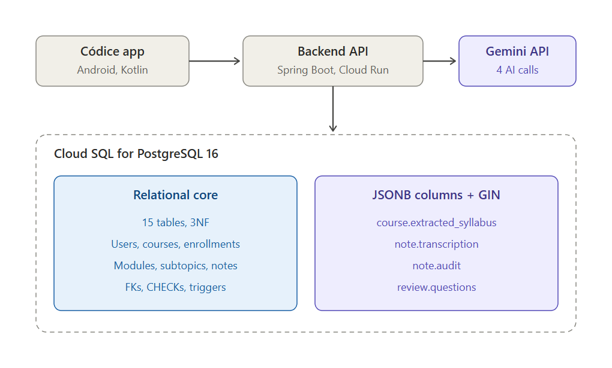
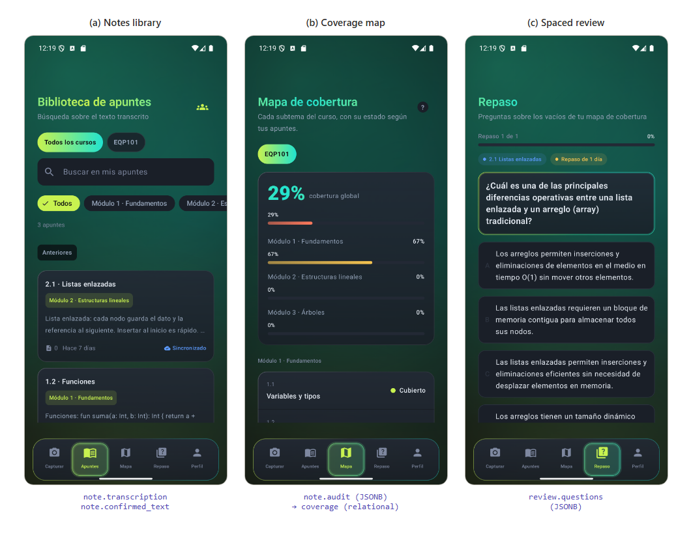
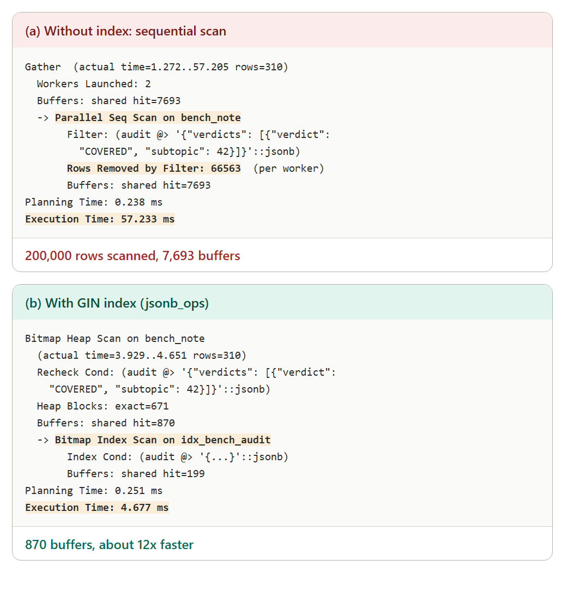

# Architectural Integration of Semi-Structured NoSQL Paradigm within Relational Schemas: A Hybrid Database Approach for AI-Driven Mobile Educational Applications

**Sebastian Benavides Madrigal, Johnny Corrales Zamora and Mishelle Rojas Chacon**
Universidad Nacional de Costa Rica
Diseño y Programación de Plataformas Móviles (EIF 411)
November 3, 2026

**Abstract —** Modern mobile educational platforms frequently integrate Artificial Intelligence (AI) to process unstructured user inputs, such as Optical Character Recognition (OCR) data, semantic syllabus audits and dynamically generated adaptive quizzes. Traditional Relational Database Management Systems (RDBMS) enforce strict third normal form (3NF) schemas, which ensure data integrity but lack the flexibility required for dynamic, unpredictable AI payloads. Conversely, pure NoSQL document stores (e.g., MongoDB, Firebase) provide schema agility but often sacrifice ACID transactions and the strong foreign key constraints [1] essential for core entities such as users, enrollments and academic hierarchies. This paper evaluates a hybrid strategy in *Códice*, an AI-powered study assistant (Android client, Spring Boot backend, Cloud SQL): a 3NF core of 15 tables plus four PostgreSQL JSONB columns in the same database, holding the raw output of four AI calls. We explain the design rules, the application-level tolerance for malformed AI output, and a reproducible benchmark of GIN-indexed containment queries against a sequential scan and a fully normalized alternative, in terms of query time, storage and write cost.

**Keywords —** PostgreSQL, JSONB, NoSQL, hybrid persistence, GIN index, mobile education, generative AI.

## 1. Introduction

Large language models return JSON whose fields change with the prompt, the model and its version. A student's note transcription may carry per-line confidence in one release and a list of flagged words in the next. Modeling every variant as columns forces a migration for each prompt change. Meanwhile, the same application needs strict guarantees elsewhere: role-based access control (RBAC), a shared course catalog with teacher-owned group sections, and active-enrollment rules. A student must not hold two active enrollments in one course, and a note must not outlive its enrollment.

Both extremes have a cost. A pure NoSQL store such as MongoDB or Firebase Realtime Database gives flexibility but weakens transactional safety and constraint enforcement across academic entities. Forcing volatile AI output into rigid relational tables, on the other hand, causes constant schema migrations and table bloat, or pushes the design toward the Entity-Attribute-Value (EAV) anti-pattern. Códice therefore embeds document storage, through PostgreSQL's native `jsonb` type, directly inside relational tables.

This tension is the motivation for polyglot persistence [1]. Running a second database (e.g. MongoDB or Firestore) adds a second deployment, a second backup policy and distributed consistency problems between stores. We ask: **can one PostgreSQL instance serve both needs, and what does it cost?**

Contributions: (1) a concrete boundary rule for what is relational and what is JSONB; (2) guards that keep schema-less AI output from corrupting the app; (3) a reproducible benchmark.

## 2. Background: Non-Relational Databases

The relational model organizes data into tables with a fixed schema and expresses integrity through keys and constraints [2]. "NoSQL" is an umbrella term for stores that depart from it, trading some of those guarantees for flexibility or scale. Four families are usually distinguished:

| Family | Data model | Typical systems | Typical use | Fit for Códice |
|---|---|---|---|---|
| Key-value | Opaque value looked up by key | Redis, DynamoDB | Caching, sessions | Low: nothing to query inside the value |
| Document | Self-describing JSON documents | MongoDB, Firestore | Evolving records, content | High for AI payloads, weak for relationships |
| Wide-column | Rows with dynamic column families | Cassandra, HBase | Very high write volume at scale | Low: Códice does not need that scale |
| Graph | Nodes and edges | Neo4j | Relationship traversal | Low: the academic hierarchy is shallow |

Two ideas explain why the choice is not trivial. The first is **schema-on-write versus schema-on-read**: a relational database validates the shape of data when it is written, whereas a document store accepts any shape and leaves interpretation to the reader. The second is **ACID versus BASE**. Many distributed NoSQL systems relax consistency to remain available under network partitions, a trade-off formalized by the CAP conjecture and theorem [3][4] and popularized as eventual consistency [5]. That trade-off is acceptable for a social feed, but not for enrollment limits or role rules.

In Códice the two kinds of data have opposite needs. Users, enrollments and the course hierarchy are small, highly related and must never be inconsistent. AI outputs are written once, read as a whole, and change shape with every prompt revision. Rather than operating two databases, we embed the document model inside the relational engine, an approach known as multi-model (Section 3).

| Criterion | Relational only | Document store only | Hybrid (Códice) |
|---|---|---|---|
| Integrity (foreign keys, constraints) | Strong | Weaker: no foreign keys, transactions vary by product | Strong on the relational core |
| Schema flexibility | Low: each change is a migration | High | High on AI payloads |
| Operational complexity | One system | One system, plus a second one for relational data | One system |
| Ad hoc queries | SQL | Store-specific query language | SQL plus JSON operators |
| Write scaling | Vertical | Horizontal | Same as relational |

## 3. Related Work

Stonebraker and Çetintemel argued that "one size fits all" no longer holds for data management [6]. Cattell surveyed scalable SQL and NoSQL stores and their trade-offs [7]. Sadalage and Fowler popularized polyglot persistence [1]. Lu and Holubová survey multi-model databases that expose several data models over one engine [8]. Chasseur, Li and Patel showed how JSON documents can be stored and queried inside relational systems, and introduced a micro-benchmark with which they compared such a scheme against MongoDB [9]. Liu, Hammerschmidt and McMahon described native JSON support in a commercial RDBMS to enable schema-less development while keeping ACID guarantees [10]. PostgreSQL implements this idea with the binary `jsonb` type and GIN inverted indexes [11]. Our work is an applied case study of that last line, in a mobile-education setting.

## 4. System Architecture and Database Design

Códice is built around a hybrid backend that supports four AI integration pipelines: syllabus extraction from a PDF, OCR transcription of handwritten notes, semantic coverage auditing of notes against the official syllabus, and adaptive review-question generation. Figure 1 shows how the pieces fit: the Android client talks to a Spring Boot backend, which calls the Gemini API and persists everything in one Cloud SQL instance, split into a relational core and JSONB columns.



*Figure 1. Códice architecture: relational core and JSONB columns in one Cloud SQL for PostgreSQL instance.*

### 4.1 Relational Core (3NF Integrity)

Identity and structure live in 15 relational tables: `users`, `role`, `privilege`, `user_role`, `role_privilege`, `course`, `student_group`, `enrollment`, `module`, `subtopic`, `subtopic_objective`, `note`, `note_page`, `coverage` and `review`. Integrity is enforced by the database, not the app:

- foreign keys with explicit `ON DELETE` actions (`CASCADE` for owned data, `SET NULL` for `note.subtopic_id`);
- `CHECK` constraints on closed vocabularies (e.g. `enrollment.status`, `review.interval_day IN (1,3,7,14,30)`);
- a **partial unique index** (`uq_enrollment_one_active_group_per_course`, on `(course_id, student_id) WHERE status = 'ACTIVE'`) that guarantees one active enrollment per course;
- a `BEFORE INSERT/UPDATE` trigger (`trg_enrollment_course_id`) that keeps `enrollment.course_id` consistent with its group;
- a shared course catalog (`course`) from which teachers instantiate group sections (`student_group`);
- `note.client_request_id UNIQUE` for idempotent uploads on flaky mobile connections.

Access control is handled in the application layer (Spring Security roles `ROLE_STUDENT` and `ROLE_TEACHER`, JWT). Row Level Security is enabled on all tables but defines no policies; it is inherited from an earlier hosting setup and plays no role in authorization.

### 4.2 Non-Relational NoSQL Embedding

Four columns hold semi-structured data, one per AI call:

| Column | AI call | Content | Primary purpose |
|---|---|---|---|
| `course.extracted_syllabus` | 1 | Modules and subtopics extracted from a syllabus PDF | Automated document ingestion |
| `note.transcription` | 2 | Handwriting OCR and confidence scores | Handwriting recognition storage |
| `note.audit` | 3 | Verdicts on which subtopics a note covers | Comparing notes to syllabus subtopics |
| `review.questions` | 4 | Generated quiz questions (model, prompt version, options) | Adaptive learning assessment |

Keeping these payloads in JSONB avoids brittle foreign-key chains and the fragmented EAV pattern that a fully normalized model of AI output would need.

**Boundary rule.** Data the app *queries by key, joins or constrains* is relational. Data the app *stores, shows and occasionally filters* is JSONB. Notably, the student's reviewed text lives in the relational column `note.confirmed_text`, never overwritten by the raw AI output in `transcription`. The JSON is evidence; the confirmed text is the source of truth.

Each document stores the producing `model` and `promptVersion`, so old rows stay interpretable after prompts evolve.

### 4.3 Integration: From Raw AI Output to Relational State

The integration follows one rule: **JSONB keeps the evidence, relational tables keep the decisions.** Two flows show how it works.

*Note transcription (AI call 2).* The raw OCR output (provider, model, prompt version, full text, per-page blocks and the blocks flagged for review) is stored in `note.transcription`. The relational column `note.confirmed_text` is deliberately left untouched: the student reviews the doubtful blocks and confirms the text, and only the confirmed text can be audited.

*Coverage audit (AI call 3).* The service sends the confirmed text and the course subtopics to the model, which returns one verdict per subtopic (`COVERED`, `PARTIAL` or `NO_NOTES`) with a quoted phrase as evidence. The parser discards verdicts for subtopics outside the course and invalid statuses, and keeps the best verdict when a subtopic is repeated. The `applyAudit` operation validates every subtopic before writing anything, so either the whole audit is recorded or none of it. It then stores the document in `note.audit` and consolidates the relational table `coverage`, which holds one row per student and subtopic with a status, a justification and the note of origin. The status `REINFORCED` is computed by the consolidation, never decided by the model. The student's coverage view reads `coverage`, not the JSON.

```
note.audit (JSONB, evidence)                        coverage (relational, decision)
{ "model": "provider:model",                        student_id    = 7
  "promptVersion": "auditoria-v1",                  subtopic_id   = 12
  "auditedAt": "2026-10-20T15:42:07Z",              status        = 'COVERED'
  "verdicts": [{ "subtopicId": 12,           --->   justification = 'Room usa entidades ...'
                 "status": "COVERED",               note_origin_id = 55
                 "evidence": "Room usa entidades ..." }] }
```

Figure 2 shows the corresponding screens of the running Android application. The notes library searches the transcribed text; the coverage map presents the relational `coverage` state per module and subtopic, computed from the audits; and the review screen renders questions stored in `review.questions`.



*Figure 2. Códice running on an Android emulator (interface in Spanish, test account): (a) notes library, (b) coverage map, (c) spaced review, with the database columns that back each screen.*

*Schema drift in practice.* Documents in the same column do not share key names: the audit contract and the stored audit use English keys (`verdicts`, `subtopicId`, `status`, `evidence`), stored transcriptions use Spanish keys (`textoCompleto`, `bloquesPorRevisar`), and the demo seed data uses yet another set. Because no relational column or query depends on those keys (the application only checks whether an audit exists), this drift required no migration, which is precisely the flexibility the hybrid design is meant to provide; the `model` and `promptVersion` fields identify which contract produced each document. The flip side is discipline: key names are agreed by convention and enforced in the service layer, not by the database.

### 4.4 Deployment on Google Cloud

The backend runs as a containerized Spring Boot service on **Google Cloud Run** (region `us-central1`, 1 GiB, 0–2 instances), connected to **Cloud SQL for PostgreSQL 16** (`db-f1-micro`, a shared-core tier). In the production profile the schema is applied by Flyway migrations at startup; the JDBC URL and the JWT secret are held in Secret Manager. Using a managed PostgreSQL means the hybrid design needs no extra infrastructure: relational and document data share one instance, one backup policy and one transaction scope. Cloud SQL supports `jsonb` and GIN indexes natively, so no managed document store (Firestore, MongoDB Atlas) was needed. This is also a deliberately small tier, which makes the cost of JSONB and GIN overhead more visible than on a large instance.

## 5. Implementation and Technical Evaluation

### 5.1 Schema Implementation

The `note` table shows the pattern: relational columns with constraints next to document columns for raw AI output.

```sql
CREATE TABLE note (
    id             BIGSERIAL PRIMARY KEY,
    enrollment_id  BIGINT NOT NULL REFERENCES enrollment(id) ON DELETE CASCADE,
    subtopic_id    BIGINT REFERENCES subtopic(id) ON DELETE SET NULL,
    client_request_id VARCHAR(100) UNIQUE,   -- upload idempotency
    confirmed_text TEXT,
    sync_status    VARCHAR(20) NOT NULL DEFAULT 'QUEUED'
                   CHECK (sync_status IN ('QUEUED','UPLOADING','SYNCED','FAILED')),
    created_at     TIMESTAMPTZ NOT NULL DEFAULT now(),
    transcription  JSONB,   -- AI call 2: raw OCR output
    audit          JSONB    -- AI call 3: raw semantic comparison
);
```

Columns are declared `JSONB` and mapped in Kotlin/Hibernate with `@JdbcTypeCode(SqlTypes.JSON)`. Because JSONB has no schema, the backend defends itself: AI responses are parsed leniently with Jackson `JsonNode`, confidences are clamped to `[0,1]`, and a malformed element (e.g. one bad quiz question or module) is **skipped rather than failing the whole request**. If the AI call itself fails, nothing is persisted, so a course is never left half-extracted. This moves schema validation from the database to a typed boundary in the service layer, which is the real price of the NoSQL side.

### 5.2 Query Optimization via Generalized Inverted Indexing (GIN)

Each JSONB column has a GIN index:

```sql
CREATE INDEX idx_note_transcription ON note   USING GIN (transcription);
CREATE INDEX idx_note_audit         ON note   USING GIN (audit);
CREATE INDEX idx_review_questions   ON review USING GIN (questions);
CREATE INDEX idx_course_syllabus    ON course USING GIN (extracted_syllabus);
```

GIN decomposes JSON keys and array elements into an inverted lookup structure that maps every key/value to the rows containing it, so key and containment queries (`@>`) avoid scanning the whole table. We measure the effect below rather than assume it. For instance, "notes whose audit marks subtopic 42 as COVERED":

```sql
SELECT id FROM note
WHERE audit @> '{"verdicts":[{"subtopic":42,"verdict":"COVERED"}]}';
```

**Experimental setup.** A synthetic dataset of 200,000 notes (1–4 findings each) was generated in a scratch database on a local PostgreSQL 18 server (`docs/investigacion/benchmark-jsonb.sql`; raw output in `docs/investigacion/resultados-benchmark.txt`). Production runs on Cloud SQL for PostgreSQL 16, so absolute times are not directly comparable; the relative differences are the object of study. The synthetic documents use simplified keys (`subtopic`, `verdict`) rather than the production keys (`subtopicId`, `status`), so the example query above is illustrative. The normalized alternative holds 500,000 findings in a separate table. We compare (a) sequential scan, (b) GIN with default `jsonb_ops`, and (c) a fully normalized `bench_finding` table with a B-tree index. We also measure whole-document reads, storage and write cost.

**Results.** Times are PostgreSQL `EXPLAIN ANALYZE` execution times from a single run.

| Query | Seq scan | GIN | Normalized + B-tree |
|---|---|---|---|
| Containment, subtopic 42 COVERED (~310 rows) | 57.2 ms | 4.68 ms | 0.39 ms |
| Read one whole audit by id | n/a | 0.021 ms (primary key) | 0.059 ms (indexed join) |

| Storage | Size |
|---|---|
| JSONB table (heap) | 60 MB |
| GIN index | 7.5 MB |
| Normalized table + indexes | 55 MB |

| Write cost (50k inserts) | Time |
|---|---|
| With GIN | 778 ms |
| Without GIN | 234 ms |

Figure 3 shows the abridged `EXPLAIN ANALYZE` plans behind the first row of the table. Without an index the planner scans the whole table in parallel and discards almost every row; with the GIN index it uses a bitmap index scan and reads about one ninth as many buffers (870 against 7,693).



*Figure 3. Query plans for the containment query on 200,000 documents: (a) sequential scan, (b) GIN index (abridged output of `EXPLAIN (ANALYZE, BUFFERS)`).*

**Discussion.** The GIN index cut the containment query from 57.2 ms to 4.68 ms (about 12x), confirming that it replaces a full scan with an index lookup. However, the normalized table answered the same filter in 0.39 ms, about 12x faster than GIN, because a B-tree on `(subtopic, verdict)` matches the predicate exactly while GIN must recheck candidate rows. Reading one whole document favored JSONB (0.021 ms against 0.059 ms for the join), which matches how a screen shows one note's audit at a time (the two reads are not strictly comparable, see the threats below). GIN has a real cost: 7.5 MB of extra storage (about 12% over the heap) and writes about 3.3x slower (778 ms against 234 ms for 50,000 rows).

The hybrid is therefore **not justified by raw query speed**. It is justified by schema agility: when a prompt changes the shape of an AI response, no migration, join table or backfill is required, and no second datastore must be operated. Fields that must be filtered often and precisely should be promoted to relational columns.

**Threats to validity.** Synthetic, uniformly random data; measured on a local PostgreSQL 18 server rather than the production Cloud SQL instance; a single run per query on one machine; no concurrent load; a mostly warm cache, although the normalized-table queries incurred a few cold page reads (`read=3` to `read=4`), which slightly penalizes them in the document-read comparison. The storage comparison is also unequal: the JSONB figure is the table heap without its primary key, whereas the normalized figure includes all of its indexes. The write timings were taken from the `psql` console (`\timing`) and are not stored in the results file, and the second insert ran on a larger table than the first. The conclusions are indicative, not general.

## 6. Conclusion

A single PostgreSQL instance can host a strictly relational core and semi-structured AI output at once. Placing the boundary by access pattern, storing model and prompt version in every document, and validating at the application boundary is designed to keep Códice consistent when prompts change; this paper measures the cost of the approach but does not include a prompt-migration experiment. Future work: the smaller `jsonb_path_ops` GIN operator class, expression indexes or generated columns promoting hot JSONB keys, a prompt-change experiment, and a comparison against a real document store.

## References

[1] P. J. Sadalage and M. Fowler, *NoSQL Distilled: A Brief Guide to the Emerging World of Polyglot Persistence*. Addison-Wesley, 2012, ISBN 978-0-321-82662-6.
[2] E. F. Codd, "A relational model of data for large shared data banks," *Communications of the ACM*, vol. 13, no. 6, pp. 377-387, 1970, doi: 10.1145/362384.362685.
[3] E. A. Brewer, "Towards robust distributed systems," keynote at the *19th ACM Symposium on Principles of Distributed Computing (PODC)*, Portland, OR, USA, 2000.
[4] S. Gilbert and N. Lynch, "Brewer's conjecture and the feasibility of consistent, available, partition-tolerant web services," *ACM SIGACT News*, vol. 33, no. 2, pp. 51-59, 2002, doi: 10.1145/564585.564601.
[5] W. Vogels, "Eventually consistent," *Communications of the ACM*, vol. 52, no. 1, pp. 40-44, 2009, doi: 10.1145/1435417.1435432.
[6] M. Stonebraker and U. Çetintemel, "'One size fits all': An idea whose time has come and gone," in *Proc. 21st IEEE Int. Conf. on Data Engineering (ICDE)*, Tokyo, Japan, 2005, pp. 2-11, doi: 10.1109/ICDE.2005.1.
[7] R. Cattell, "Scalable SQL and NoSQL data stores," *ACM SIGMOD Record*, vol. 39, no. 4, pp. 12-27, 2011, doi: 10.1145/1978915.1978919.
[8] J. Lu and I. Holubová, "Multi-model databases: A new journey to handle the variety of data," *ACM Computing Surveys*, vol. 52, no. 3, pp. 1-38, 2019, doi: 10.1145/3323214.
[9] C. Chasseur, Y. Li and J. M. Patel, "Enabling JSON document stores in relational systems," in *Proc. 16th Int. Workshop on the Web and Databases (WebDB)*, New York, NY, USA, 2013, pp. 1-6.
[10] Z. H. Liu, B. C. Hammerschmidt and D. McMahon, "JSON data management: Supporting schema-less development in RDBMS," in *Proc. ACM SIGMOD Int. Conf. on Management of Data*, Snowbird, UT, USA, 2014, pp. 1247-1258, doi: 10.1145/2588555.2595628.
[11] The PostgreSQL Global Development Group, "JSON types" and "GIN indexes," *PostgreSQL 16 Documentation*. [Online]. Available: https://www.postgresql.org/docs/16/datatype-json.html and https://www.postgresql.org/docs/16/gin.html (accessed Nov. 3, 2026).
